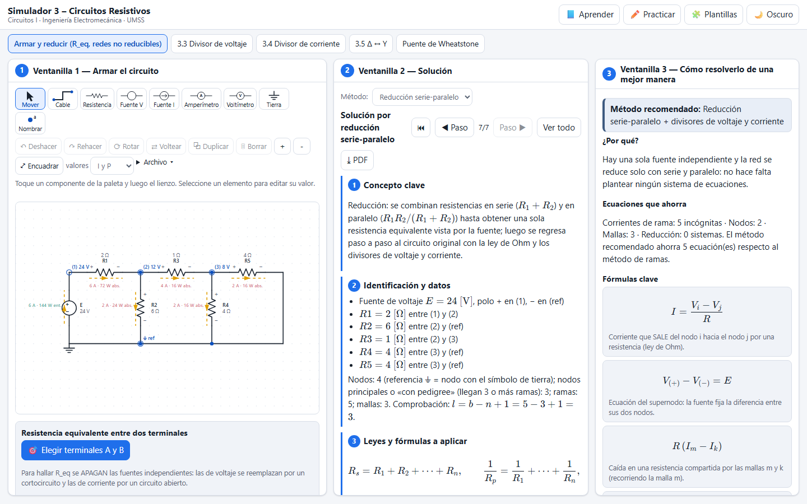
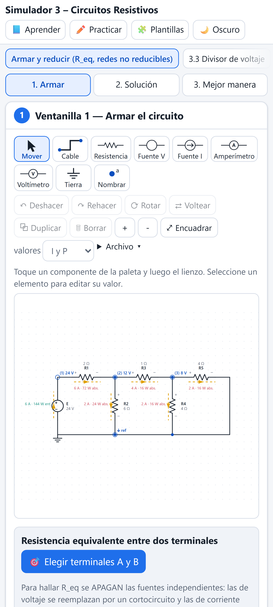

# Simulador 3 – Circuitos Resistivos

Simulador web interactivo de la **Unidad 3 de Circuitos I** (sigla 197900021, Ingeniería Electromecánica, UMSS – Cochabamba, Bolivia; docente Ing. Abg. Juan Antonio Rodríguez Sejas). Sirve para practicar resistencias en serie y en paralelo, la resistencia equivalente entre cualquier par de terminales, los divisores de voltaje y de corriente, las transformaciones Δ ↔ Y, el puente de Wheatstone y el regreso paso a paso al circuito original.

**Página publicada:** https://angelja19.github.io/simulador-3-circuitos-resistivos/

| Escritorio | Celular |
| --- | --- |
|  |  |

## Cómo se usa

La pantalla tiene tres ventanillas (en el celular se cambia entre ellas con botones):

1. **Armar el circuito / Datos:** el editor gráfico, o los datos de cada herramienta, con resultados en vivo y un panel de errores.
2. **Solución:** el desarrollo en 7 puntos por reducción, por nodos o por mallas. Muestra las fórmulas del material, por ejemplo «producto sobre suma» y los divisores de voltaje y de corriente.
3. **Cómo resolverlo de una mejor manera:** el camino más corto, atajos y errores típicos.

Además están **Aprender**, **Practicar** (con progreso guardado), **Plantillas** y el tema claro u oscuro.

## Funciones

- **Armar y reducir:** se arma cualquier red y se elige cualquier par de terminales para calcular la resistencia equivalente, con una animación etapa por etapa (original → reducción → reducido). Las fuentes se apagan: las de voltaje pasan a ser un cortocircuito y las de corriente un circuito abierto. Si la red no se puede reducir solo con serie y paralelo, el simulador lo detecta y propone qué triángulo transformar en estrella. Después vuelve al circuito original con las corrientes, los voltajes y las potencias de cada resistencia.
- **3.3 Divisor de voltaje:** con n resistencias en serie, en cascada y con efecto de carga entre etapas o sobre R_L. Indica las condiciones de uso.
- **3.4 Divisor de corriente:** con dos o n ramas en paralelo, usando la resistencia opuesta en el numerador.
- **3.5 Δ ↔ Y (Π ↔ T):** conversión en ambos sentidos con dibujo y fórmulas. Incluye el caso de resistencias iguales (R/3 y 3R).
- **Puente de Wheatstone:** balanceado y no balanceado, con la condición de equilibrio, la corriente por el galvanómetro y el valor de R₄ que balancea.

## Casos verificados por las pruebas

| Caso | Resultado |
| --- | --- |
| Cuaderno: divisor en cascada 28 V; 10 y 4 Ω; luego 2 y 4 Ω | V_ab = 8 V; V_bc = 5,33 V; P ≈ 7,1 W (etapas sin efecto de carga) |
| Cuaderno: Δ → Y con 10, 65 y 25 Ω | 6,5; 2,5 y 16,25 Ω |
| Cuaderno: Δ de 9 Ω → Y de 3 Ω; 18 ∥ 27 ∥ 18 | R_eq = 6,75 Ω |
| Material: 15 V con 1 kΩ y 250 ∥ 500 | V_ab = 2,14 V; V_R1 = 12,86 V |
| Material: 1 kΩ + 250 ∥ 500 ∥ 1500 | 1150 Ω |
| Material: 2 A en 100 ∥ 500 ∥ 1500 | I_R2 = 0,32 A; I_R3 = 0,105 A |
| Puente no balanceado | la reducción con Δ→Y coincide con el análisis nodal |

Las fórmulas del curso están en [`docs/formulas.md`](docs/formulas.md).

## Ejecutarlo en su computadora

```bash
npm install
npm run dev
```

## Pruebas

```bash
npm test                     # motor, casos del cuaderno y cálculos (Vitest)
npx playwright install chromium
npm run test:e2e             # interfaz en escritorio y celular (Playwright)
```

## Licencia

[MIT](LICENSE)
